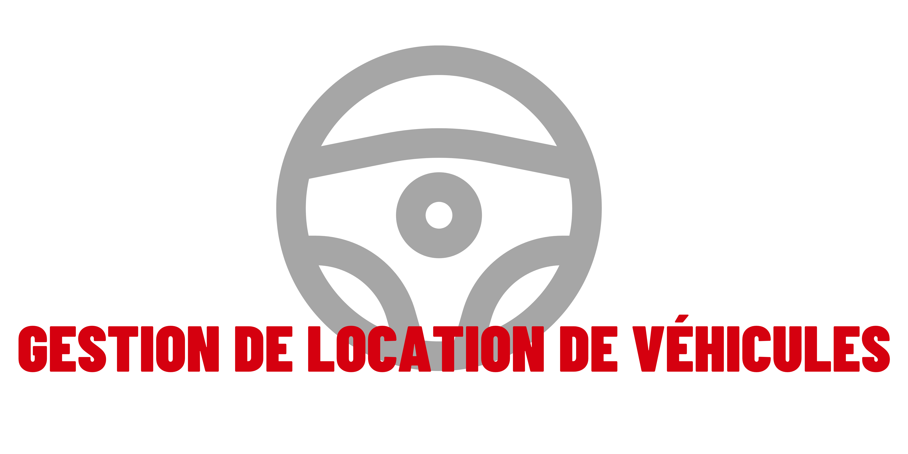

# Journal de bord : TPI - Gestion de location de voitures

## S1 : Lundi 01 Mai 2023

### Etape du projet
Début du projet

### Objectifs
Comprendre l'énoncé du TPI, faire le planning initiale, crée le repository sur github, faire l'arborescence du projet,
initié le projet, faire le kanban sur le repository et faire le maquettage.

### Déroulement de la journée
> 8h00 - 9h30  
>
J'ai pris connaissance de l'énoncé du TPI. J'ai crée la planification initial via Canva.  
J'ai fait le repository sur github mais pour l'instant il y a uniquement le README.md du projet. J'ai mis en place une arborescence pour la documentation pour mieux m'y retrouver.  
Je commence le kanban sur Github.

> 11h35  
>
Je continue sur la réalisation du kanban sur git. J'ai eu mon premier appel avec Kappel, j'ai eu l'occasion de poser les questions importantes.  
Je comprends mieux de ce qu'il doit être fait.  

> 15h45  
>
J'ai enfin terminer le kanban. Le repo a bien été lié au projet en local. Le projet a été inité, les dépendances sont installées, stack installé, breeze installé, nettoyage des fichiers inutiles, la clé a été genérée, lien symbolique fait et des commits qui font référence aux issues du projet.

> 17h50
>
J'ai bien demarré sur la maquette :  
- Login terminer
- Création / Modification de comptes terminer

J'ai pu déjà réfléchir pour la base de données.  
Je met au propre mon journal de travail.

### Bilan de la journée
Je vois ce que je dois faire, j'ai bien avancé mais j'aurais bien voulu terminer la maquette aujourd'hui. 

## S1 : Mardi 02 Mai 2023

### Etape du projet
Maquette et Modèle de données

### Objectifs
Terminer la maquette, le modèle de données et commencer la documentation.

### Déroulement de la journée
>  8h50
>
Je me lance sur la finalisation du la maquette.
Je remarque qu'il y pas mal d'information a montrer comme les vues de chaques rôles,
les sections et la version "sombre" du site.

>  12h00
>
J'effectue encore la maquette :
- Gestion de la flotte : Fait
Cela prend du temps, car je réfléchit à comment faire au plus simple pour le "responsive".

Petit appel avec Kappel, pour une question sur le nom d'une section.

>  16h00
>
J'ai enfin terminer la maquette dans son ensemble avec toutes les vues et mode sombre du site.  
  
J'ai eu mon premier rendez-vous avec l'expert TPI.  
La disscusion a été super cela m'a permis de destresser et de mieux me centrer sur les objectifs à réaliser.

Maintenant j'attaque le début de la documentation technique pour effectuer sa structure et je finalise le modèle de données.

>  19h00
>

J'ai terminé toute la structure du manuel technique! Maitenant, je peux maintenir durant ma réalisation. J'ai presque terminer le modèle de données.

### Bilan de la journée
J'ai bien avancé même si l'objectif était de terminer le modèle de données, je l'ai compensé sur le temps que j'aurais passé sur la structure de la documentation du projet.  
Demain, je termine le modèle et je peux commencer la réalisation avec avec l'écriture des tests.  

## S1 : Mercredi 03 Mai 2023

### Etape du projet
Fin du modèle de données, Début de la réalisation / Tests

### Objectifs
Finir le modèle, faire le layout du projet, faire les models et les fichiers de migration, s'assurer des tests de connexion et mettre en place le multilingue.

### Déroulement de la journée
>  8h50
>  
Je me lance sur la finalité du modèle. J'ai hâte de commencer la réalisation.

>  10h45
> 
J'ai terminé le modèle, j'ai mis à jour mon kanban et mon repos ainsi que la maquette.  
Je me suis lancé sur la réalisation, je fais les models et les tables à crée au moment d'une migration.  
La table "users" et son model a déjà été crée mais avec le minimum d'information donc j'ai faire certaines corrections.  
La table "langues" et le model sont terminés.

>  11h11
> 
Tout a été faite concernant les models et les tables par contre j'ai eu une erreur de syntaxe sur "Hors d'usage".  
Au lieu de passer du temps pour contourner l'erreur, j'ai simplement mis des underscores sur les espaces.  

>  14h20
> 
Je m'assure des layouts, je vérifie du fonctionnement du "login" car il y a eu pas mal de modification dans le projet.  
Les tests concernant le login fonctionne.
Début des modifications et création des layouts importants.

>  14h40 - 14h55
>  
Bon, il y a eu un test incencdie pour s'assurer que l'entreprise s'évacue correctement.  
Mon élan a été arreté, on s'y remet.

>  15h40
>  
J'ai du modifier la direction d'une connexion réussite pour qu'il passe sur la page "creation_modification_comptes".  
Pour ce faire, il a fallu aller dans le "RouteServiceProvider" et modifier la valeur de la constante HOME.  
J'ai effectuer des changements sur l'emplacement sur certains fichiers pour mieux respecter l'arborecense du dossier "views".  
J'ai effecté une mise à jour de NPM et Composer.
J'ai fait un petit logo gratuitement mais il a gardé l'arrière plan blanc. J'ai utilisé le site "remove.bg" pour m'en débaraser.
Puis le favicon.ico pour transformer mon logo via favicon.io

>  17h40
>  
La page "Login" est terminer avec son darkmode!  
Le layout Guest est bien adapté.
Maitenant je m'attaque à la navigation bar

>  18h40
>  
J'ai eu un leger souci sur la navbar car le nom et prenom de l'utilisateur ne s'affichait pas.
Mais j'ai pu la terminer et tout les layouts sont terminer pour correspondre au mieux à la maquette avec un peu de modernisation sur le design.
Avec aussi le mode dark et le responsive mobile.
Je me connecte parfaitement donc demain je peux faire enfin le plus gros, c'est à dire les sections.

### Bilan de la journée
Je suis assez content de moi sur l'avancement du projet.
Mais je n'ai pas encore toucher à la documentation depuis la structure, je pense qu'elle fera partie des objectifs de demain.