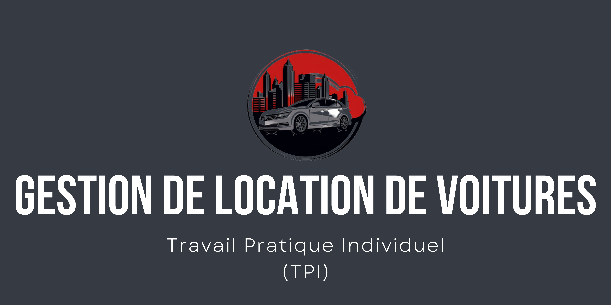

# Journal de bord : TPI - Gestion de location de voitures

## S1 : Lundi 01 Mai 2023

### Etape du projet
Début du projet

### Objectifs
Comprendre l'énoncé du TPI, faire le planning initiale, crée le repository sur github, faire l'arborescence du projet,
initié le projet, faire le kanban sur le repository et faire le maquettage.

### Déroulement de la journée
> 8h00 - 9h30  
>
J'ai pris connaissance de l'énoncé du TPI. J'ai crée la planification initial via Canva.  
J'ai fait le repository sur github mais pour l'instant il y a uniquement le README.md du projet. J'ai mis en place une arborescence pour la documentation pour mieux m'y retrouver.  
Je commence le kanban sur Github.

> 11h35  
>
Je continue sur la réalisation du kanban sur git. J'ai eu mon premier appel avec Kappel, j'ai eu l'occasion de poser les questions importantes.  
Je comprends mieux de ce qu'il doit être fait.  

> 15h45  
>
J'ai enfin terminer le kanban. Le repo a bien été lié au projet en local. Le projet a été inité, les dépendances sont installées, stack installé, breeze installé, nettoyage des fichiers inutiles, la clé a été genérée, lien symbolique fait et des commits qui font référence aux issues du projet.

> 17h50
>
J'ai bien demarré sur la maquette :  
- Login terminer
- Création / Modification de comptes terminer

J'ai pu déjà réfléchir pour la base de données.  
Je met au propre mon journal de travail.

### Bilan de la journée
Je vois ce que je dois faire, j'ai bien avancé mais j'aurais bien voulu terminer la maquette aujourd'hui. 

## S1 : Mardi 02 Mai 2023

### Etape du projet
Maquette et Modèle de données

### Objectifs
Terminer la maquette, le modèle de données et commencer la documentation.

### Déroulement de la journée
>  8h50
>
Je me lance sur la finalisation du la maquette.
Je remarque qu'il y pas mal d'information a montrer comme les vues de chaques rôles,
les sections et la version "sombre" du site.

>  12h00
>
J'effectue encore la maquette :
- Gestion de la flotte : Fait
Cela prend du temps, car je réfléchit à comment faire au plus simple pour le "responsive".

Petit appel avec Kappel, pour une question sur le nom d'une section.

>  16h00
>
J'ai enfin terminer la maquette dans son ensemble avec toutes les vues et mode sombre du site.  
  
J'ai eu mon premier rendez-vous avec l'expert TPI.  
La disscusion a été super cela m'a permis de destresser et de mieux me centrer sur les objectifs à réaliser.

Maintenant j'attaque le début de la documentation technique pour effectuer sa structure et je finalise le modèle de données.

>  19h00
>

J'ai terminé toute la structure du manuel technique! Maitenant, je peux maintenir durant ma réalisation. J'ai presque terminer le modèle de données.

### Bilan de la journée
J'ai bien avancé même si l'objectif était de terminer le modèle de données, je l'ai compensé sur le temps que j'aurais passé sur la structure de la documentation du projet.  
Demain, je termine le modèle et je peux commencer la réalisation avec avec l'écriture des tests.  

## S1 : Mercredi 03 Mai 2023

### Etape du projet
Fin du modèle de données, Début de la réalisation / Tests

### Objectifs
Finir le modèle, faire le layout du projet, faire les models et les fichiers de migration, s'assurer des tests de connexion et mettre en place le multilingue.

### Déroulement de la journée
>  8h50
>  
Je me lance sur la finalité du modèle. J'ai hâte de commencer la réalisation.

>  10h45
> 
J'ai terminé le modèle, j'ai mis à jour mon kanban et mon repos ainsi que la maquette.  
Je me suis lancé sur la réalisation, je fais les models et les tables à crée au moment d'une migration.  
La table "users" et son model a déjà été crée mais avec le minimum d'information donc j'ai faire certaines corrections.  
La table "langues" et le model sont terminés.

>  11h11
> 
Tout a été faite concernant les models et les tables par contre j'ai eu une erreur de syntaxe sur "Hors d'usage".  
Au lieu de passer du temps pour contourner l'erreur, j'ai simplement mis des underscores sur les espaces.  

>  14h20
> 
Je m'assure des layouts, je vérifie du fonctionnement du "login" car il y a eu pas mal de modification dans le projet.  
Les tests concernant le login fonctionne.
Début des modifications et création des layouts importants.

>  14h40 - 14h55
>  
Bon, il y a eu un test incencdie pour s'assurer que l'entreprise s'évacue correctement.  
Mon élan a été arreté, on s'y remet.

>  15h40
>  
J'ai du modifier la direction d'une connexion réussite pour qu'il passe sur la page "creation_modification_comptes".  
Pour ce faire, il a fallu aller dans le "RouteServiceProvider" et modifier la valeur de la constante HOME.  
J'ai effectuer des changements sur l'emplacement sur certains fichiers pour mieux respecter l'arborecense du dossier "views".  
J'ai effecté une mise à jour de NPM et Composer.
J'ai fait un petit logo gratuitement mais il a gardé l'arrière plan blanc. J'ai utilisé le site "remove.bg" pour m'en débaraser.
Puis le favicon.ico pour transformer mon logo via favicon.io

>  17h40
>  
La page "Login" est terminer avec son darkmode!  
Le layout Guest est bien adapté.
Maitenant je m'attaque à la navigation bar

>  18h40
>  
J'ai eu un leger souci sur la navbar car le nom et prenom de l'utilisateur ne s'affichait pas.
Mais j'ai pu la terminer et tout les layouts sont terminer pour correspondre au mieux à la maquette avec un peu de modernisation sur le design.
Avec aussi le mode dark et le responsive mobile.
Je me connecte parfaitement donc demain je peux faire enfin le plus gros, c'est à dire les sections.

### Bilan de la journée
Je suis assez content de moi sur l'avancement du projet.

## S1 : Jeudi 04 Mai 2023

### Etape du projet
Démarage des sections

### Objectifs
Finir le plus de section possible, avec les fichiers de test, les fichiers de traduction,
les fonctionnalitées etc..

### Déroulement de la journée
>  8h00
>  
Je demmare a faire des bloc de section pour mieux répartir les fonctionnalitées de la page.

>  10h30
> 
J'ai énormement eu de problème sur la réalisation du carousel, que j'ai décidé de le remplacer par une système d'overflow.
Cela me permet d'eviter de surcharger de condition mon block de résumer et de le rendre le plus accèsible d'un point de vue utilisateur.
Les fonctionnalités de l'administrateur, a été compliqué sur le plan de la modification car j'ai du passer par du AJAX pour afficher les informaitons sans recharger la page complète dans le modal de modification..

>  13h00
> 
J'ai pu mettre en place les fonctionnalités, j'ai eu une erreur sur la gestion des routes concernant les middlewares, cela m'a fait perdre du temps sur la réalisation de la page 
"Création/Modification de comptes."
Les fichiers tests et langues sont faite avec l'option DarkMode ainsi que la résponsivité.

>  14h30
> 
Je me suis lancé sur la réalisation de la page "Gestion de la flotte", ma première crainte est sur la création de deux tag avec système de séléction. J'ai patogé un peu mais j'ai rapidement trouver la solution qu'est le système de Datalist. Par le controlleur, je peux verifier son existance et sinon je la crée puis je renvoie l'information par l'index qui permet a la vue blade de boucler sur les tag existant dans la datalist.

>  16h40
>  
J'ai eu des problèmes sur l'upload de l'image avec ça prévisualisation. La résponvité a décidé de m'embeter. J'ai du retoucher la structure de la table "Vehicule" car il y a eu plusieurs problèmes. La première est que la clé primaire était auto-incrémenter et en d'un nombre entier, alors que je souhaitais pouvoir la modifier en chaine de carcatere et qu'il soit obligatoire et non auto-incérmentale. La seconde est le nom du statut : Hors d'usage, les underscores sont pratique un moment mais par pour le moment de la réalisation. mais j'ai résolue le problème par l'utilisation d'une quote spécial.

>  18h00
>  
Les fichiers de langues sont faite, aussi je dois faire les tests mais pour cela je dois 
faire la gestion des réservations pour tester les résultats des véhicules loués. Le résponsive à été faite, le dark mode aussi.

### Bilan de la journée
Le projet avance. Je ne m'attendais pas à autant d'erreur ou de souci.
Mentalement, ça été compliqué car je souhait terminer l'application rapidement pour effectuer la documentation mais je dois me resigner à attendre la semaine prochaine.  
La gestion des réservations me fait un peu peur concernant le faite que le gestionnaire peut réserver un vehicule pour un client et que je dois faire en sorte que le calcul du montant soit faite en temps réels.

## S2 : Lundi 08 Mai 2023

### Etape du projet
Finir les sections.

### Objectifs
Finir les sections et s'assurer de la résponsivité des pages et de l'accèsibilité.

### Déroulement de la journée
>  8h00
>  
Je reprend là où je me suis arreté, c'est à dire la quasi finalité de la page "Gestion de la flotte" mais je dois réaliser la page "Gestion des réservations" pour la finir.

>  10h30
> 
C'était dur de récuperer la durée de location, le tarif ainsi que la label du montant du véhicule concerner. J'ai fait un jquery de selection large avec la variable "this" puis j'ai mis des attributs de type "data-" a l'input de la durée pour récuperer le tarif et le numero de la carte du véhicule concerner. J'ai pu réflichir sur la réservation du client par le gestionnaire, en utilisant un input fantome qui récupère de la selection pour l'integrer a la "value" de l'input fantome. Je dois faire un argument non obligatoire pour la réservation et pour la recherche de la page aussi. j'ai encore pas mal de boulot.  
Je met à jour le kanban et le repos aussi.

>  14h15
>
La gestion des réservations (GdR) est presque terminer, je retourne sur la gestion de la flotte (GdF).  
Car une fois terminer la page GdR, je peux vérifier que le prénom et nom du client s'affiche correctement, les dates de locations et que les statut réagissent correctement. Je dois encore m'amuser avec AJAX et le retour correct des données sur la BDD.

>  18h00
>
J'ai enfin terminer les deux pages, qui ont été long et technique mais j'y suis parvenu maintenant j'attaque la dernière page qu'est le tableau de bord.
### Bilan de la journée
La journée a été bonne mais encore un fois, il y a certaines choses je penses que j'aurais pu être plus rapide.  
Sinon je suis content de voir le bout du projet, du côté "Application".

## S2 : Mardi 09 Mai 2023

### Etape du projet
Integrer la modification de date pour la démonstration, finir les tests, finir les fichiers LANG.

### Objectifs
Mon but est de ne plus toucher à l'application pour me mettre à 100% sur la documentation, les README etc.

### Déroulement de la journée
>  8h00
>  
Je termines encore certaines correction sur le liens des pages entre les réservations, le résultat du rapport et la gestion de la flotte.

>  10h30
> 
J'ai des erreurs sur l'integration des données entre la table Location et Véhicule, donc j'essaye de le corriger au plus vite. Mais sinon dans l'ensemble, cela fonctionne ça réagit comme je le souhaite.

>  14h15
>
Tout est terminé mais j'ai dû mal à savoir comment je vais intégrer la modification de date,  
car normalement la réservation se fait au jours même avec une durée donnée par le client.  
Je ne compte pas passer par les fichiers de configuration car je devrais changer ma manière de récuperation de la date actuelle et je n'arrive pas à faire en sorte que la donnée soit prioritaire avec Carbon.

>  18h00
>
J'ai enfin terminé, la manière dont j'allais intégrer, je suis passé par une session du nom "currentDate". Une donnée effectue par une demande Ajax en méthode POST. Je l'ai intégré dans la page Tableau de bord puisque c'est là qu'on peut voir la manière dont on peux modifier les locations. Pas mal de condition ternaire pour choisir la session si elle existe sinon on passe par la fonction "now()" de Carbon pour éviter qu'il n'y ai aucune valeur.  

Grâce à cette réussite, j'ai pu finir mon plus gros test sur le tableau de bord pour s'assurer que la modification de statut du véhicule se fasse après la date de fin et aussi qu'elle ne se fasse pas avant. J'ai pu terminer les fichiers LANG donc la traduction s'effectue correctement sur toutes les pages!

### Bilan de la journée
Super content d'avoir terminer l'application, je peux enfin me concentrer sur la documentation et aussi soulage qu'une partie de la document est déjà "réaliser" car ayant fait mes tests fonctionnels par PEST passant par Laravel Artisan. J'ai mes petits userstory avec les résultats et un affichage correcte est compréhensible. Donc toutes une section de la document concernant les tests. Demain, je peux me concacrer à la doc serainement.

## S2 : Mercredi 10 Mai 2023

### Etape du projet
Mettre à jour le repos, le kanban, s'assurer que le journal de bord est bon, commencer la documentation technique.
### Objectifs
Avoir fini la section TEST sur la documentation technique et que tout soit en ordre entre Kanban, Repos et fichiers.
### Déroulement de la journée
>  8h00
>  
Je m'assure que l'application est bon une dernière fois avant de mettre à jour le repos et de commit sur les issues terminées.

>  10h00
>  
Je relis mon journal de bord, pour être que je n'ai rien oublié et je me lance sur la documentation Technique.

### Bilan de la journée