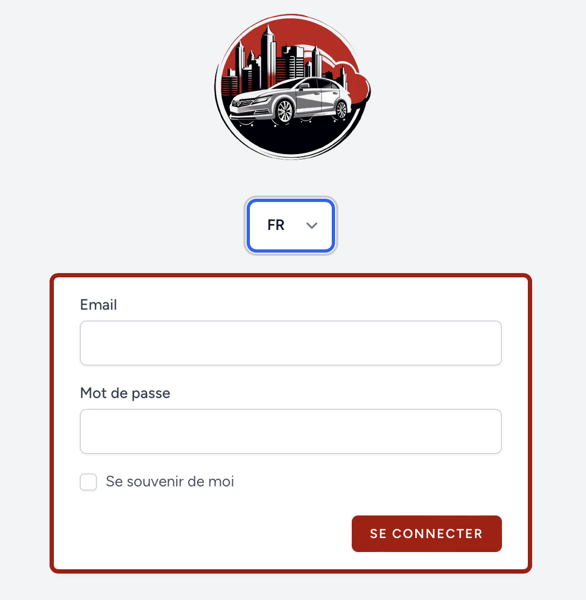
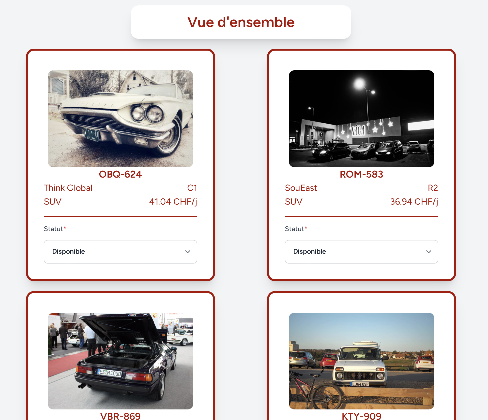
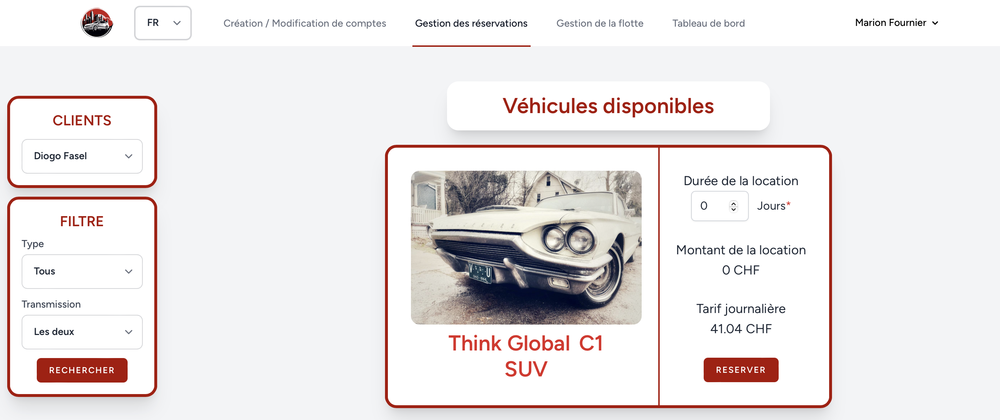
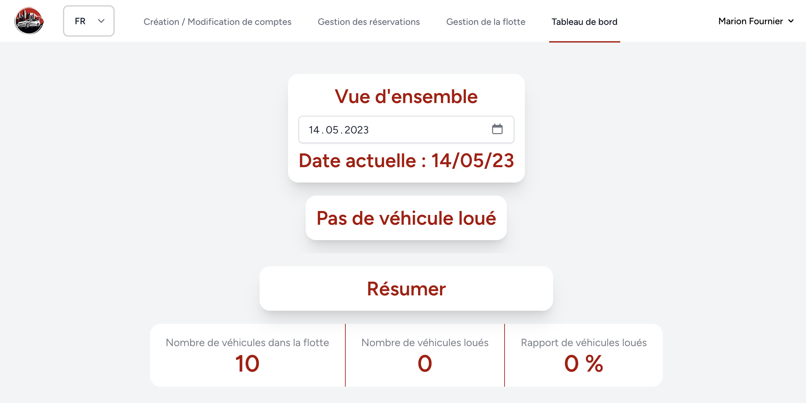

<p align="center">
  
</p>

<h1 align="center">🚗 Car Rental Management — CFC TPI</h1>

<p align="center">
  <strong>Final certification project · Application Development · May 2023</strong><br>
  A complete web application for managing a car-rental company's users, fleet, reservations and operational dashboard.
</p>

<p align="center">
  <a href="https://mrleodev.github.io/TPI/"><strong>🌐 Live interactive showcase</strong></a>
  &nbsp;·&nbsp;
  <a href="Application/Gestion_location_voitures"><strong>💻 Browse source code</strong></a>
</p>

<p align="center">
  
  
  
  
  
</p>

> **Portfolio note**  
> This repository preserves the project I delivered for my Swiss **CFC application-development TPI**. The application source is intentionally kept as it was submitted; only the repository presentation may be improved over time. The GitHub Pages showcase is a static presentation built from the original project screenshots and does not expose the legacy Laravel application as a production service.

## 🎯 Project goal

The objective was to build a web application allowing a car-rental company to manage its daily activity through different user roles.

The application covers the complete flow from account and fleet administration to vehicle reservations and operational monitoring.

## ✨ Main features

- 👥 **Role-based access** for Administrator, Manager and Client users
- 🚘 **Fleet management** with vehicle creation, status management and vehicle information
- 📅 **Reservation management** for clients and managers
- 💰 **Dynamic rental amount calculation** based on duration and vehicle pricing
- 📊 **Operational dashboard** to monitor rentals and vehicle status
- 🔐 **Authentication and authorization** with dedicated middleware
- 🌍 **Multilingual interface**
- 🌙 **Dark mode**
- 📱 **Responsive interface**
- ⚡ **AJAX interactions** for selected workflows without full-page reloads
- 🧪 **Functional test suite** covering the main application areas

## 👤 User roles

| Role | Main responsibilities |
| --- | --- |
| **Administrator** | User/account administration, personal information management, dashboard access |
| **Manager** | Fleet management, reservations, dashboard and vehicle-status management |
| **Client** | Browse available vehicles and create reservations |

## 🖥️ Application preview

### Login

<p align="center">
  
</p>

### Fleet management

<p align="center">
  
</p>

### Reservation management

<p align="center">
  
</p>

### Dashboard

<p align="center">
  
</p>

## 🧱 Technical stack

| Area | Technologies |
| --- | --- |
| **Backend** | PHP 8.1 · Laravel 10 · Laravel Breeze |
| **Frontend** | Blade · Tailwind CSS 3 · DaisyUI · Alpine.js · jQuery |
| **Build tooling** | Vite 4 |
| **Testing** | Pest 2 · Laravel testing tools |
| **Architecture** | MVC · Middleware-based authorization · Eloquent models/migrations |

## 🧪 Testing

Testing was part of the project rather than an afterthought. The repository contains dedicated feature tests for the core application areas:

- Account creation/modification
- Fleet management
- Reservation management
- Dashboard behaviour
- Authentication
- Route and access-control behaviour

The test suite can be found under [`Application/Gestion_location_voitures/tests`](Application/Gestion_location_voitures/tests).

## 📚 Project documentation

The TPI deliverable also included extensive project documentation:

- 📝 [Work journal](Documentation/Documents/JournalDeTravail.md)
- 📘 [Technical manual](Documentation/Documents/Manuel_technique.docx)
- 👤 [User manual](Documentation/Documents/Manuel_utilisateur.docx)
- 📅 [Initial planning](Documentation/Documents/PlanificationPr%C3%A9visionnelle_du_TPI.pdf)
- 📈 [Effective planning](Documentation/Documents/PlanificationEffective_du_TPI.pdf)
- 📋 [Project specification / Cahier des charges](Documentation/Documents/TPI%20-%20Cahier%20des%20charges%20-%20Location%20de%20voitures%20-%20Leonel%20Borges.pdf)
- 🗃️ [Database modelling documentation](Documentation/BDD)
- 🎨 [UI mockups](Documentation/Maquettes)

## 🔎 How to explore this repository

If you only want to understand the result without installing the application:

1. Open the **[interactive showcase](https://mrleodev.github.io/TPI/)** for a guided visual tour.
2. Browse the screenshots below or in the documentation.
3. Read the **User Manual** for the complete functional flow.
4. Read the **Work Journal** to follow the project decisions and progress during the TPI.
5. Browse the **Technical Manual** and database model for the implementation choices.
6. The original application source is available under [`Application/Gestion_location_voitures`](Application/Gestion_location_voitures).

## 📁 Repository structure

```text
TPI/
├── Application/
│   └── Gestion_location_voitures/   # Original Laravel application
├── Documentation/
│   ├── BDD/                         # Database modelling
│   ├── Code/                        # Code extracts used in the report
│   ├── Documents/                   # Journal, manuals, planning, specification
│   └── Maquettes/                   # UI mockups
└── README.md                        # Portfolio presentation
```

---

<details>
<summary><strong>🇫🇷 Lire la présentation en français</strong></summary>
<br>

## 🎓 À propos du projet

Ce dépôt contient mon **TPI de développeur d'applications réalisé dans le cadre de l'obtention de mon CFC** en mai 2023.

L'objectif était de réaliser une application web complète permettant à une société de location de voitures de gérer ses utilisateurs, sa flotte de véhicules, ses réservations et le suivi opérationnel de son activité.

Le code de l'application est volontairement conservé dans son état de remise afin de préserver le projet tel qu'il a été présenté lors de mon TPI. Seule la présentation du dépôt est modernisée pour permettre de comprendre rapidement le résultat.

Une **[vitrine interactive GitHub Pages](https://mrleodev.github.io/TPI/)** présente les principaux écrans à partir des captures originales, sans exposer l'ancienne application Laravel comme service de production.

## ✨ Fonctionnalités principales

- 👥 Gestion de plusieurs rôles : **Administrateur**, **Gestionnaire** et **Client**
- 🚘 Gestion de la flotte de véhicules
- 📅 Gestion des réservations
- 💰 Calcul dynamique du montant d'une location
- 📊 Tableau de bord et suivi des statuts des véhicules
- 🔐 Authentification et autorisations via middleware
- 🌍 Interface multilingue
- 🌙 Mode sombre
- 📱 Interface responsive
- ⚡ Interactions AJAX
- 🧪 Tests fonctionnels sur les principaux parcours

## 🧭 Pour découvrir le résultat

Il n'est pas nécessaire d'installer le projet pour comprendre ce qui a été réalisé :

1. Commencez par la **[vitrine interactive](https://mrleodev.github.io/TPI/)** pour parcourir visuellement le projet.
2. Les captures d'écran du dépôt donnent un aperçu direct de l'application.
3. Le [manuel utilisateur](Documentation/Documents/Manuel_utilisateur.docx) présente les différents parcours fonctionnels.
4. Le [journal de travail](Documentation/Documents/JournalDeTravail.md) retrace la réalisation et les décisions prises pendant le TPI.
5. Le [manuel technique](Documentation/Documents/Manuel_technique.docx) et la [documentation de la base de données](Documentation/BDD) détaillent la conception technique.
6. Le code original est disponible dans [`Application/Gestion_location_voitures`](Application/Gestion_location_voitures).

</details>

---

<p align="center">
  <sub>Original certification project preserved as submitted · Portfolio presentation updated afterwards.</sub>
</p>
